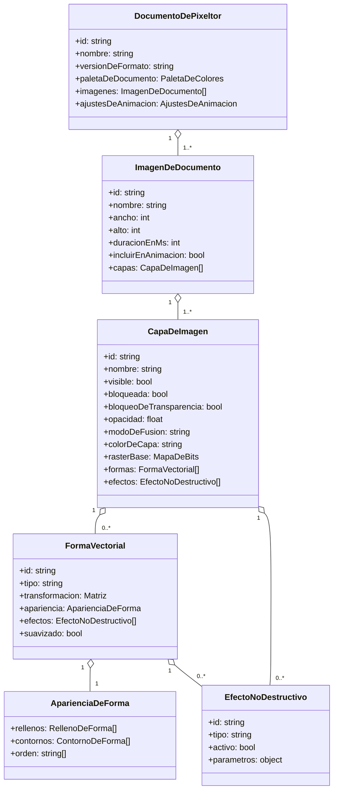

# 02 · Modelo de documento

## Jerarquía

```
Documento (.pixeltor)
├─ ajustes (paleta del documento, cuadrícula, guías por defecto, fondo)
├─ animación (bucle, modo)
└─ imágenes[]                 ← orden = orden de animación
   └─ capas[]                 ← índice 0 = capa inferior
      ├─ ráster base (RGBA W×H)
      ├─ formas[]             ← índice 0 = forma inferior dentro de la capa
      │  ├─ geometría (paramétrica o trazado)
      │  ├─ apariencia: rellenos[] + contornos[] (pila ordenada)
      │  └─ efectos[]
      └─ efectos de capa[]
```

## Diagrama de clases (vista conceptual)



> En el código se usan identificadores en inglés (abajo). El diagrama es para documentación.

## Tipos TypeScript (contrato para `src/core/model`)

```ts
export type ID = string;               // nanoid(10)
export type RGBA = { r: number; g: number; b: number; a: number }; // 0-255 cada uno
export type Vec2 = { x: number; y: number };                       // coordenadas de imagen (px, float)
export type Mat2D = [a: number, b: number, c: number, d: number, e: number, f: number];

export interface PixeltorDocument {
  id: ID;
  formatVersion: string;               // semver, p.ej. "1.0.0"
  name: string;
  images: PxImage[];
  palettes: Palette[];                 // la primera es la paleta del documento
  animation: { loop: 'loop' | 'pingpong' | 'once'; };
  settings: DocumentSettings;
  metadata: { createdAt: string; modifiedAt: string; app: string };
}

export interface DocumentSettings {
  grid: { enabled: boolean; cellW: number; cellH: number; color: RGBA; };   // cuadrícula de tiles
  pixelGridMinZoom: number;            // por defecto 8 (800 %)
  background: 'transparent' | RGBA;    // solo afecta a exportación si se elige "con fondo"
  snapToPixel: 'integer' | 'half' | 'off';  // ajuste de coordenadas vectoriales
}

export interface PxImage {
  id: ID;
  name: string;
  width: number;                       // 1..2048
  height: number;
  durationMs: number;                  // 10..60000, por defecto 100
  includeInAnimation: boolean;
  layers: Layer[];                     // [0] = inferior
  guides: Guide[];
  slices?: Slice[];                    // [F5] regiones con nombre para exportar
}

export type BlendMode =
  | 'normal' | 'multiply' | 'screen' | 'overlay' | 'darken' | 'lighten'
  | 'add' | 'subtract' | 'difference' | 'color-dodge' | 'color-burn' | 'hue' | 'saturation' | 'color' | 'luminosity';

export interface Layer {
  id: ID;
  name: string;
  visible: boolean;
  locked: boolean;
  lockAlpha: boolean;                  // pintar solo donde ya hay píxeles
  opacity: number;                     // 0..1
  blendMode: BlendMode;
  color: string;                       // color de identificación (trazos vectoriales en el lienzo)
  raster: RasterRef;                   // ráster base W×H (puede estar vacío = null data)
  shapes: Shape[];                     // [0] = inferior
  effects: Effect[];
  clipToBelow?: boolean;               // [F7] máscara de recorte con la capa inferior
  groupId?: ID;                        // [F7] grupos de capas
}

/** El buffer real vive fuera del modelo reactivo, indexado por id. */
export interface RasterRef { id: ID; width: number; height: number; }

// ---------- Formas ----------

export type Shape = RectShape | EllipseShape | LineShape | PolygonShape | StarShape | PathShape | GroupShape;

interface ShapeBase {
  id: ID;
  name: string;
  visible: boolean;
  locked: boolean;
  opacity: number;
  blendMode: BlendMode;
  transform: Mat2D;                    // local → imagen
  appearance: Appearance;
  effects: Effect[];
  antialias: boolean;                  // por defecto false
}

export interface RectShape    extends ShapeBase { kind: 'rect';    w: number; h: number; radius: [number, number, number, number]; }
export interface EllipseShape extends ShapeBase { kind: 'ellipse'; rx: number; ry: number; }
export interface LineShape    extends ShapeBase { kind: 'line';    a: Vec2; b: Vec2; }
export interface PolygonShape extends ShapeBase { kind: 'polygon'; sides: number; radius: number; }
export interface StarShape    extends ShapeBase { kind: 'star';    points: number; r1: number; r2: number; }
export interface PathShape    extends ShapeBase { kind: 'path';    subpaths: SubPath[]; fillRule: 'nonzero' | 'evenodd'; }
export interface GroupShape   extends Omit<ShapeBase, 'appearance'> { kind: 'group'; children: Shape[]; appearance?: Appearance; }

export interface SubPath { closed: boolean; anchors: Anchor[]; }
export interface Anchor {
  p: Vec2;
  in: Vec2 | null;                     // tirador de entrada (absoluto, coords locales); null = sin tirador
  out: Vec2 | null;
  type: 'corner' | 'smooth' | 'symmetric';
}

// Las formas paramétricas (rect, ellipse, polygon, star) se pueden convertir a 'path'
// con "Objeto › Convertir en trazado" (pierden los parámetros, no los píxeles).

// ---------- Apariencia ----------

export interface Appearance {
  /** Orden de dibujo de abajo hacia arriba; ids de fills y strokes mezclados (como Illustrator). */
  stack: ID[];
  fills: Fill[];
  strokes: Stroke[];
}

export interface Fill { id: ID; enabled: boolean; paint: Paint; opacity: number; blendMode: BlendMode; effects?: Effect[] /* [F4] efecto por atributo */; }

export interface Stroke {
  id: ID; enabled: boolean; paint: Paint; opacity: number; blendMode: BlendMode;
  width: number;                       // entero ≥ 1 (px)
  align: 'center' | 'inside' | 'outside';
  cap: 'butt' | 'round' | 'square';
  join: 'miter' | 'round' | 'bevel';
  miterLimit: number;
  dash?: number[];                     // en px, enteros
  pixelPerfect: boolean;               // eliminar esquinas en "L" en trazos de 1 px
  offset?: number;                     // desplazamiento extra hacia fuera/dentro (contornos múltiples)
}

export type Paint = SolidPaint | GradientPaint | PatternPaint;
export interface SolidPaint { type: 'solid'; color: RGBA; swatchId?: ID; }
export interface GradientPaint {
  type: 'linear' | 'radial' | 'angular';
  stops: { offset: number; color: RGBA; }[];   // offset 0..1
  from: Vec2; to: Vec2;                        // coordenadas locales de la forma
  pixelMode: GradientPixelMode;
}
export type GradientPixelMode =
  | { mode: 'smooth' }
  | { mode: 'bands'; steps: number }                         // escalones duros
  | { mode: 'dither'; matrix: 'bayer2' | 'bayer4' | 'bayer8' | 'checker'; steps: number }
  | { mode: 'palette'; paletteId: ID; dither: boolean };     // cuantizar a paleta
export interface PatternPaint { type: 'pattern'; tile: RasterRef; offset: Vec2; } // [F7]

// ---------- Efectos ----------

export interface Effect {
  id: ID;
  type: EffectType;                    // ver 06-efectos.md
  enabled: boolean;
  params: Record<string, unknown>;     // validado por el esquema del efecto
  output?: EffectOutputMode;
}
export type EffectOutputMode = { alpha: 'keep' | 'threshold' | 'dither'; threshold?: number; quantizeToPalette?: ID; };
```

## Reglas de integridad

- Una imagen DEBE tener al menos una capa. Un documento DEBE tener al menos una imagen.
- Los IDs son únicos en todo el documento.
- `Layer.raster` siempre tiene el tamaño de su imagen. Cambiar el tamaño del lienzo redimensiona/recorta los rásters y desplaza las formas según el ancla elegida.
- Los parámetros de efectos se validan con un esquema por tipo; valores fuera de rango se limitan (clamp) al cargar.
- Las coordenadas de formas son **float** en px de imagen. El ajuste a píxel (snap) se aplica al editar, no al guardar.
- Las formas en una capa bloqueada no se pueden seleccionar con el lienzo, pero sí desde el panel Capas (sin editar).

## Selección

```ts
export interface SelectionState {
  imageId: ID;
  activeLayerId: ID;
  shapes: ID[];                        // formas seleccionadas (herramienta Selección)
  anchors: { shapeId: ID; subpath: number; index: number }[]; // Selección directa
  pixels: PixelMask | null;            // selección de píxeles (marquesina/lazo/varita)
  floating: FloatingPixels | null;     // píxeles movidos aún no fijados
}
```

La selección no forma parte del documento guardado, pero sí del historial (deshacer restaura la selección previa).
